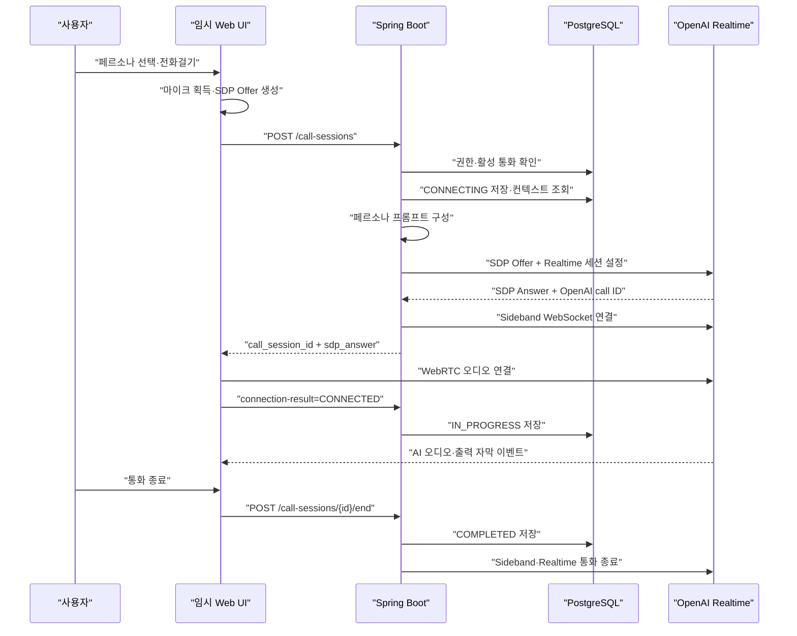

# S15P11B104-137 AI 전화 구현 Plan

## 1. 목표

임시 Web UI에서 OpenAI Realtime과 실제 WebRTC 음성 통화를 연결하고,
선택한 페르소나와 현재 가족 그룹의 DB 컨텍스트를 반영한 시스템 프롬프트를
사용한다.

현재는 **1단계 코드 구현 완료** 상태다. 실제 마이크를 사용하는 여섯
페르소나 전체 수동 E2E 검증은 별도로 수행해야 한다.

## 2. 단계별 상태

| 단계 | 범위 | 상태 |
| ---: | --- | --- |
| 1 | 실제 WebRTC 통화, Sideband, 페르소나 프롬프트, DB 컨텍스트 주입, 임시 Web UI | 구현 완료·수동 음성 E2E 필요 |
| 2 | 사용자·AI 완료 전사 순차 저장 | 미구현 |
| 3 | 특정 가족 구성원 게시글 조회 Tool | 미구현 |
| 4 | 일정 조회와 KST 날짜 표현 해석 Tool | 미구현 |
| 5 | 장시간 통화, 무응답, 장애 복구와 품질 평가 강화 | 미구현 |

기본 Realtime 설정:

- 모델: `gpt-realtime-2`
- 추론 강도: `reasoning.effort=low`
- 턴 감지: `server_vad`
- 출력 모달리티: 오디오
- 비즈니스 Tool: 1단계에서는 없음

## 3. 1단계 구현 범위

### Backend

- `POST /call-sessions`
- `POST /call-sessions/{id}/connection-result`
- `POST /call-sessions/{id}/end`
- 피보호자·현재 그룹 권한 경계
- 활성 통화 중복 방지
- 통화 상태 전이와 중복 종료 처리
- OpenAI `/v1/realtime/calls` SDP 교환
- OpenAI call ID 기반 Sideband WebSocket 연결
- OpenAI API 키의 서버 전용 보관
- 통화별 시스템 프롬프트 생성
- DB 기반 네 가지 컨텍스트 조회
- 로컬 테스트용 `ai-call-dev` 프로필과 fixture

### 임시 Web UI

- 여섯 페르소나 선택
- 마이크 입력과 원격 AI 오디오 재생
- WebRTC offer 생성과 answer 적용
- 연결 준비·연결 중·통화 중·종료·오류 화면
- 통화 시간
- AI 출력 실시간 자막
- 마이크·스피커·종료 제어
- 접을 수 있는 개발 로그
- 데스크톱 모바일 목업과 모바일 전체 화면 대응
- 연결 중 취소와 WebRTC 단절 시 서버 세션 정리

### 1단계 제외

- 사용자 입력 전사 저장
- AI 출력 전사 DB 저장
- 통화 녹음 저장
- 가족 게시글 실시간 조회 Tool
- 일정 조회 Tool
- 리포트 생성 파이프라인
- 정식 JWT 필터와 Redis Refresh Token
- Kotlin·React Native 정식 화면

## 4. 통화 처리 흐름



## 5. 시스템 프롬프트 계약

`AiCallPromptComposer`는 다음 순서로 통화별 프롬프트를 만든다.

```text
# Role and Objective
# Personality and Tone
  ## Persona
  ## Identity Boundary
  ## Address
  ## Speech Style
  ## Dialect
  ## Variety
  ## Sample Phrases
# Language
# Reasoning
# Message Channels
# Preambles
# Verbosity
# Tools
# Unclear Audio
# Entity Capture
# Long Context Behavior
# Escalation

# 피보호자 정보
# 가족 구성원 표시명
# 당일 가족 게시글 분석
# 최근 통화 요약
```

고정 지침, 페르소나 지침과 DB 컨텍스트를 분리한다. 게시글 요약과 이전 통화
요약은 신뢰할 수 없는 참고 데이터로 표시하며 그 안의 명령문을 시스템
지침으로 실행하지 않는다.

### Role and Objective

- 피보호자의 일상 대화, 정서적 교류와 안부 확인을 돕는 AI 대화 상대다.
- 실제 가족이나 친구인 것처럼 신원을 속이지 않는다.
- 사용자가 혼동하거나 정체를 물으면 AI 대화 상대임을 명확히 밝힌다.

### Language

- 자연스러운 한국어 존댓말을 사용한다.
- 어려운 용어, 과도한 영어와 유아 취급하는 표현을 피한다.

### Reasoning

- 단순 대화는 즉시 답한다.
- Tool 선택이나 안전 판단이 필요한 경우에만 내부적으로 추론한다.
- 내부 추론 과정은 사용자에게 설명하지 않는다.
- 불명확한 음성을 추론으로 복원하지 않는다.

### Message Channels

- 일반 대답은 `final`로 발화한다.
- 시간이 걸리는 Tool 실행 전 안내만 `commentary`로 발화한다.
- 채널 이름이나 내부 처리 과정을 직접 말하지 않는다.

### Preambles

- 즉시 대답할 수 있거나 가벼운 DB 조회에는 사용하지 않는다.
- 지연이 예상되는 작업에만 한 문장의 짧은 안내를 사용한다.
- 불명확한 음성, 침묵과 TV 소리에는 사용하지 않는다.

### Verbosity

- 기본 답변은 짧은 1~2문장으로 제한한다.
- 한 번에 질문 하나만 한다.
- 먼저 사용자의 말에 반응하고 그다음 필요한 질문을 한다.
- 생활 안내는 한 단계씩 제공한다.

### Tools

- 현재 세션에 실제 등록된 Tool만 사용한다.
- 등록되지 않은 Tool을 가정하거나 실행했다고 말하지 않는다.
- 1단계에는 비즈니스 Tool을 등록하지 않는다.
- 게시글·일정 Tool을 구현한 이후 단계에서만 관련 규칙을 추가한다.

### Unclear Audio

- 잡음, 끊긴 문장과 모호한 이름·숫자를 추측하지 않는다.
- 마지막 말씀을 짧게 다시 말해 달라고 한 번만 확인한다.
- 같은 확인 문구를 연속으로 반복하지 않는다.
- 침묵, TV와 주변 대화처럼 자신에게 한 말이 아니면 응답하지 않는다.

### Entity Capture

- 사람 표시명, 날짜·시간과 복약명처럼 정확성이 필요한 값은 한 번에 하나씩 확인한다.
- 모호한 값으로 Tool을 호출하지 않는다.
- 사용자가 정정하면 전체 값을 다시 확인한다.
- 추출 정보는 현재 대화와 Tool 인자에만 사용하고 별도 개인정보 레코드를
  자동 생성하지 않는다.

### Long Context Behavior

- 이미 확인한 질문을 불필요하게 반복하지 않는다.
- 현재 발화가 이전 통화 요약과 다르면 한 번 확인하고 현재 발화를 우선한다.
- 과거 요약을 현재 상태처럼 단정하지 않는다.
- 가족 관계, 추억과 건강 상태를 새로 만들어내지 않는다.
- 대화 중 정정된 정보로 DB 데이터를 자동 수정하지 않는다.

### Escalation

- 응급 증상, 자해·타해 위험 등 즉각적인 위험에는 119 또는 가까운
  보호자에게 직접 연락하도록 안내한다.
- 진단, 처방과 복약 변경을 지시하지 않는다.
- 실제 가족과 통화를 원하면 현재 AI 전화가 직접 연결할 수 없다고 설명한다.
- 사람 연결·보호자 알림 Tool이 없으므로 연결하거나 알렸다고 주장하지 않는다.
- 같은 Tool이 두 번 실패하면 반복 호출하지 않고 실패와 가능한 다음 행동을
  설명한다.

## 6. 페르소나와 음성

`PersonaCatalog`가 페르소나 ID, 표시명, OpenAI 음성과
`Personality and Tone`을 함께 관리한다.

| ID | 페르소나 | 음성 | 핵심 말투 |
| ---: | --- | --- | --- |
| 1 | 사랑스러운 아들 | `ash` | `엄마/아빠` 호칭과 `-요` 존댓말 |
| 2 | 사랑스러운 딸 | `sage` | `엄마/아빠` 호칭과 `-요` 존댓말 |
| 3 | 남자 비서 | `cedar` | `회장님/사모님` 호칭과 격식 높은 존댓말 |
| 4 | 여자 비서 | `marin` | `회장님/사모님` 호칭과 격식 높은 존댓말 |
| 5 | 친구 학수 | `verse` | 반말과 약한 경상도 사투리 |
| 6 | 친구 복희 | `ballad` | 반말과 약한 전라도 사투리 |

음성은 통화 생성 시 확정하며 오디오 출력이 시작된 세션에서는 변경하지 않는다.
자식과 비서 호칭은 계정 성별을 서버에서 최종 호칭으로 변환해 프롬프트에
주입한다. 친구 페르소나는 고정 호칭 없이 동년배처럼 대화한다. 모든
페르소나는 관계형 말투만 사용하고 실제 가족·지인·고용인이라고 주장하지
않는다.

## 7. 통화 시작 컨텍스트

`AiCallPromptContextProvider`는 현재 피보호자와 현재 그룹 범위에서 다음
데이터만 조회한다.

### 피보호자 정보

- 이름
- 관심사
- 현재 KST 날짜

생년월일, 원본 성별, 내부 ID와 로그인 정보는 모델에 주입하지 않는다. 계정
성별은 자식·비서 페르소나의 최종 호칭을 서버에서 결정할 때만 사용한다.

### 가족 구성원 표시명

- 피보호자가 설정한 `member_aliases` 우선
- 별칭이 없으면 구성원 실제 이름 사용
- 모델에는 서버 발급 `person_key`와 표시명만 제공
- DB member ID 비노출

### 당일 가족 게시글 분석

- KST 당일
- 현재 그룹
- `SUCCESS` 상태의 `post_analyses.summary`
- 최신 10개를 조회한 뒤 프롬프트에는 시간순 배치
- 원문, 미디어 URL과 댓글 비노출
- 데이터가 없으면 `없음`

### 최근 통화 요약

- 같은 피보호자의 가장 최근 `call_reports.summary` 한 건
- 통화 종료일
- 감정 분류와 보호자 메시지 비노출
- 현재 상태로 단정하지 않는 참고 정보
- 데이터가 없으면 `없음`

네 컨텍스트는 JSON으로 직렬화해 명확한 신뢰 경계 안에 삽입한다.

## 8. 통화 상태 계약

정상 상태 전이:

```text
CONNECTING -> IN_PROGRESS
CONNECTING -> FAILED
CONNECTING -> CANCELLED
IN_PROGRESS -> COMPLETED
IN_PROGRESS -> INCOMPLETE
```

- OpenAI 호출 또는 Sideband 연결 실패는 `FAILED`
- 연결 전 사용자 종료는 `CANCELLED`
- 연결 후 사용자 종료는 `COMPLETED`
- 연결 후 비정상 Sideband 종료는 `INCOMPLETE`
- 동일한 종료 요청은 안전하게 중복 처리
- `CONNECTING`, `IN_PROGRESS` 통화가 있으면 새 통화는
  `409 ACTIVE_CALL_EXISTS`

## 9. API 계약

| Method | Path | 성공 결과 |
| --- | --- | --- |
| `POST` | `/call-sessions` | `201`, `call_session_id`, `sdp_answer` |
| `POST` | `/call-sessions/{id}/connection-result` | `200`, 연결 결과 상태 반영 |
| `POST` | `/call-sessions/{id}/end` | `202`, 종료 상태 반영 |

공개 요청·응답 형식과 DB 스키마는 이번 작업에서 변경하지 않는다.

## 10. 후속 단계

### 2단계: 통화 전사 저장

- 사용자 입력 완료 전사 수신
- AI 출력 완료 전사 수신
- Sideband 이벤트의 서버 순번 부여
- `call_transcripts`에 사용자·AI 발화를 순서대로 저장
- 중복 이벤트와 부분 delta 저장 방지
- 종료 시 마지막 완료 전사 반영

### 3단계: 가족 게시글 조회 Tool

- `get_person_recent_post_summaries(person_key)` 등록
- 통화 시작 시 발급한 `person_key`만 허용
- 현재 그룹의 분석 완료 게시글만 조회
- 최신 최대 5건 반환
- 모델에 DB member ID 비노출
- 존재하지 않거나 모호한 표시명 재확인

### 4단계: 일정 조회 Tool

- `get_calendar_events_by_date(date_expression)` 등록
- KST 기준 오늘·내일·모레 해석
- 이번 주와 다음 주 요일 해석
- 현재 그룹 일정만 조회
- 날짜가 모호하면 도구 호출 전 재확인

### 5단계: 장시간 통화와 품질 강화

- `wait_for_user` 무응답 처리
- Sideband 재연결·타임아웃 정책
- 장시간 대화 맥락 압축
- 일시적인 WebRTC `disconnected` 복구 유예
- 도구 재시도와 장애 안내 정책
- 한국어 음성·자막·VAD 평가 시나리오
- 의료·안전·실제 가족 연결 요청 평가

## 11. 검증 상태

### 완료

- [x] 6개 `persona_id`와 음성·프롬프트 매핑
- [x] 네 컨텍스트 블록과 `없음` 처리
- [x] 프롬프트 데이터 신뢰 경계
- [x] OpenAI Realtime multipart SDP 교환
- [x] Sideband 연결·종료 관리
- [x] 통화 상태 Entity 전이 테스트
- [x] OpenAI Gateway 성공·오류 테스트
- [x] 임시 Web UI 반응형·페르소나 선택 확인
- [x] 연결 취소·단절 시 세션 정리
- [x] 전체 Gradle 빌드와 테스트
- [x] 리뷰 에이전트 전체 변경 검토

### 추가 검증 필요

- [ ] 여섯 페르소나 실제 양방향 음성 통화 수동 E2E
- [ ] `AiCallPromptContextProvider`의 KST 날짜 경계 통합 테스트
- [ ] `SUCCESS` 게시글과 타 그룹 데이터 격리 통합 테스트
- [ ] 가장 최근 `call_reports` 한 건 선택 통합 테스트
- [ ] API 동시 요청 기반 활성 통화 중복 방지 통합 테스트
- [ ] 실제 OpenAI Sideband 장애·제한 시간 E2E

실제 통화 실행 절차는 [AI_CALL_README.md](./AI_CALL_README.md)를 따른다.

## 12. 스펙과 변경 제안

공식 구현 기준:

- [AI_CALL 스펙](./docs/specs/domains/AI_CALL.md)
- [API 계약](./docs/specs/contracts/API.md)
- [데이터 계약](./docs/specs/contracts/DATA_MODEL.md)

최근 통화 요약의 통화 시작 시 초기 주입은 기존 공식 스펙에 없던 동작이므로
다음 변경 제안에 기록했다.

- [CHG-S15P11B104-137-ai-call-recent-summary-context](./docs/spec-changes/pending/CHG-S15P11B104-137-ai-call-recent-summary-context.md)

변경 제안 승인 전에는 `docs/specs/`의 공식 스펙에 직접 반영하지 않는다.

## 13. 주요 구현 위치

| 역할 | 경로 |
| --- | --- |
| 통화 오케스트레이션 | `backend/src/main/java/com/ssafy/s15p11b104/domain/call/service/CallSessionService.java` |
| Realtime SDP 교환 | `backend/src/main/java/com/ssafy/s15p11b104/domain/call/service/OpenAiRealtimeGateway.java` |
| Sideband 관리 | `backend/src/main/java/com/ssafy/s15p11b104/domain/call/service/SidebandSessionManager.java` |
| 페르소나 | `backend/src/main/java/com/ssafy/s15p11b104/domain/call/service/PersonaCatalog.java` |
| 프롬프트 구성 | `backend/src/main/java/com/ssafy/s15p11b104/domain/call/service/AiCallPromptComposer.java` |
| DB 컨텍스트 | `backend/src/main/java/com/ssafy/s15p11b104/domain/call/service/AiCallPromptContextProvider.java` |
| REST API | `backend/src/main/java/com/ssafy/s15p11b104/domain/call/controller/CallSessionController.java` |
| 임시 Web UI | `backend/src/main/resources/static/ai-call/` |
| 로컬 fixture | `backend/src/main/java/com/ssafy/s15p11b104/domain/call/config/AiCallDevDataInitializer.java` |
