<div align="center">

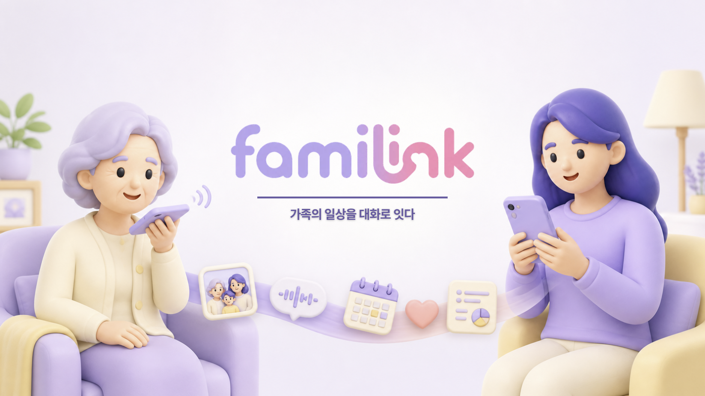

# familink

### AI 안부전화와 가족의 일상 공유를 연결한 정서 돌봄 서비스

SSAFY 15기 2학기 공통 프로젝트 · 대전 1반 B104

<p>
  
  
  
  
  
  
  
</p>

<p>
  
  
  
  
  
</p>

[프로젝트 소개](#프로젝트-소개) · [핵심 기능](#핵심-기능) · [시스템 설계](#시스템-설계) · [팀과 기여](#팀과-기여) · [실행 방법](#로컬-실행)

</div>

---

## 프로젝트 소개

바쁜 일상 속에서 부모님께 매일 전화드리기는 어렵고, 어르신이 가족 앱을 자주 확인하는 것도 쉽지 않습니다. **familink**는 어르신이 원할 때 AI에게 전화를 걸어 가족의 최근 소식과 일정을 묻고, 보호자는 통화 리포트와 가족 피드로 서로의 하루를 확인할 수 있게 만든 Android 서비스입니다.

| 문제 | familink의 접근 | 구현 결과 |
|---|---|---|
| 연락해야 한다는 부담 | 어르신이 직접 거는 6종 페르소나 AI 안부전화 | 실시간 음성 대화·자막·가족 소식 Tool Calling |
| 통화 내용을 함께 알기 어려움 | 통화·일일 리포트로 핵심만 전달 | 요약·감정·전달 메시지와 생성 상태 복구 |
| 가족 소통이 일회성으로 끝남 | 피드·캘린더·카네이션을 하나의 그룹 경험으로 연결 | 미디어 피드, 보관함, 일정 알림, 주간 랭킹 |

### 기술적 특징

- **도메인 중심 모듈러 모놀리스**: 계정·그룹·피드·캘린더·리포트·알림을 하나의 Spring Boot 애플리케이션 안에서 책임별로 분리했습니다.
- **직접 업로드 미디어 파이프라인**: 앱이 S3 Presigned URL로 사진·영상을 바로 업로드하여 백엔드의 대용량 파일 중계를 없앴습니다.
- **운영 가능한 배포 흐름**: Commit SHA 이미지, SSM 원격 명령, 이중 health check와 자동 rollback으로 동일한 이미지를 검증하고 배포했습니다.
- **DB 계약 관리**: PostgreSQL 16, Flyway 12개 마이그레이션과 Hibernate `validate`로 24개 테이블의 변경 이력을 관리했습니다.

---

## 핵심 기능

### 1. AI 안부전화와 리포트

6종 페르소나 중 원하는 상대를 선택하면 OpenAI Realtime API 기반의 양방향 음성 대화가 시작됩니다. AI는 가족 피드의 최근 소식과 공용 캘린더 일정을 Tool Calling으로 조회하며, 통화 후에는 건별 리포트와 일일 리포트가 생성됩니다.

| 페르소나 선택 | 실시간 음성 대화·자막 | 통화 리포트 |
|:---:|:---:|:---:|
| 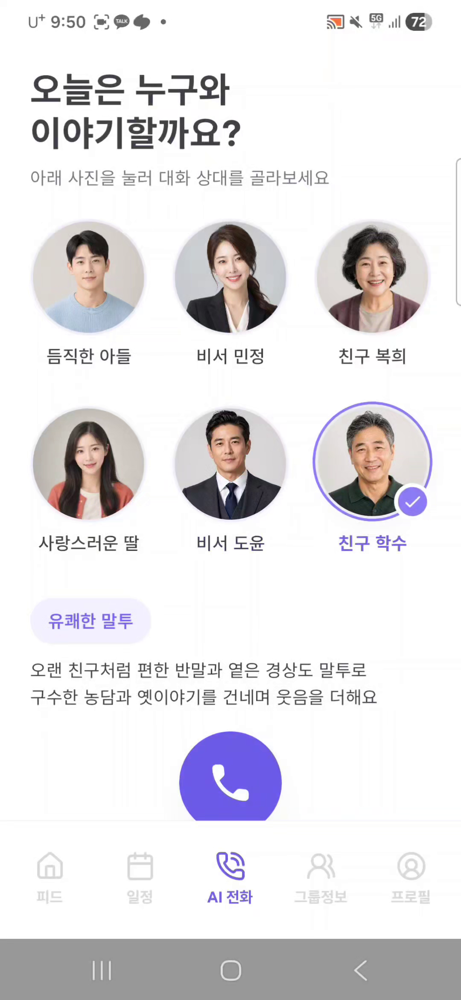 | 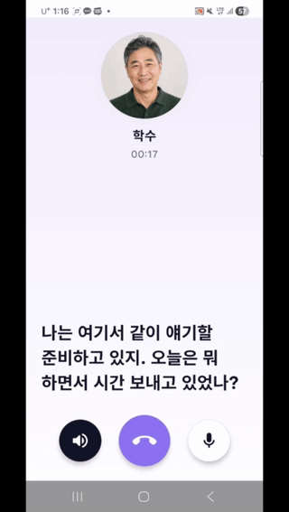 | 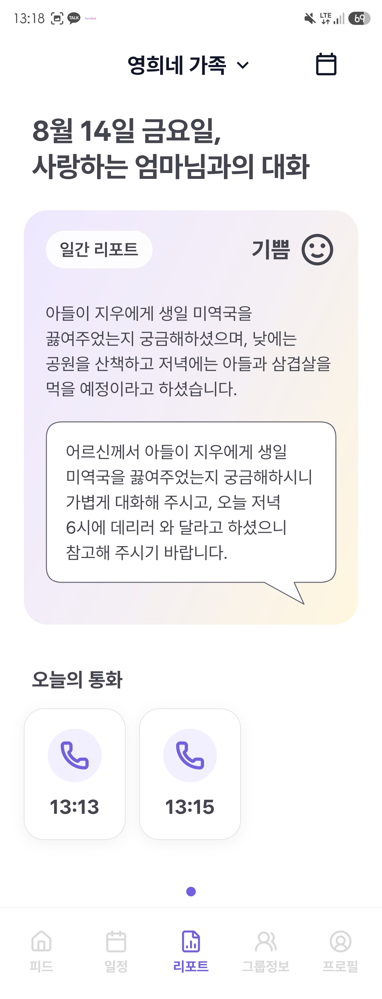 |

### 2. 가족 피드와 미디어 보관함

140자 본문과 사진 1~4장 또는 영상 1개로 일상을 공유하고 댓글·반응을 남깁니다. 미디어는 비공개 S3에 직접 업로드하며, 보관함에서 구성원·날짜·미디어 유형별로 다시 찾을 수 있습니다.

| 가족 피드 | 게시글 상세·댓글 | 미디어 보관함 |
|:---:|:---:|:---:|
| 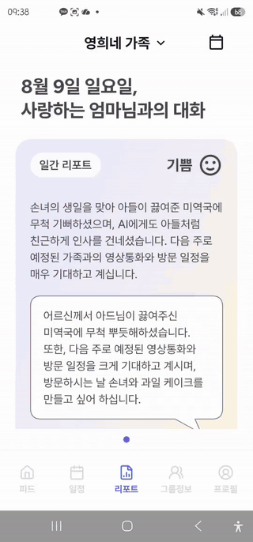 | 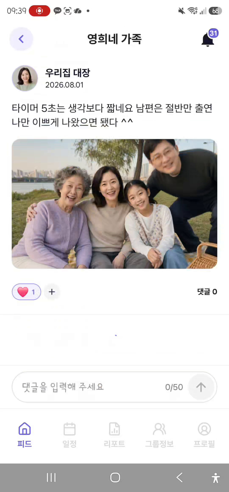 | 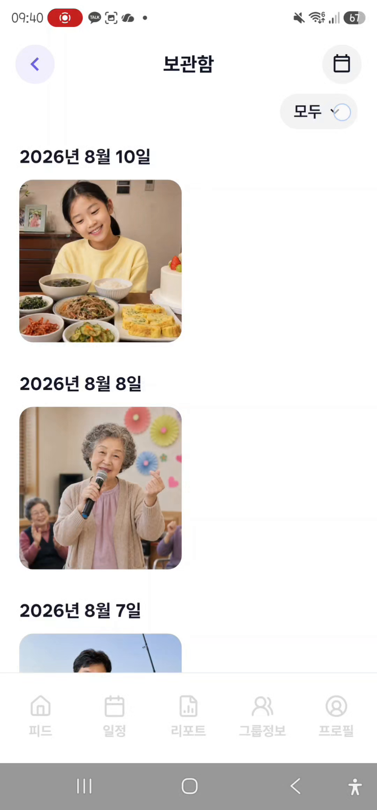 |

### 3. 가족 일정과 그룹 관리

그룹 초대 코드와 관리자 승인으로 가족을 연결하고, 여러 가족 그룹을 전환해 사용합니다. 공용 캘린더에는 참여자를 지정할 수 있으며 일정 시작 알림을 앱과 FCM으로 전달합니다.

| 월간 캘린더 | 일정 상세 | 그룹 전환 |
|:---:|:---:|:---:|
| 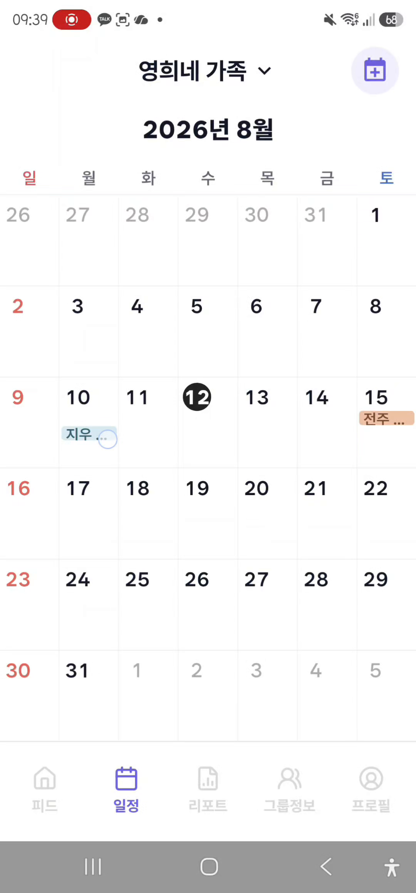 | 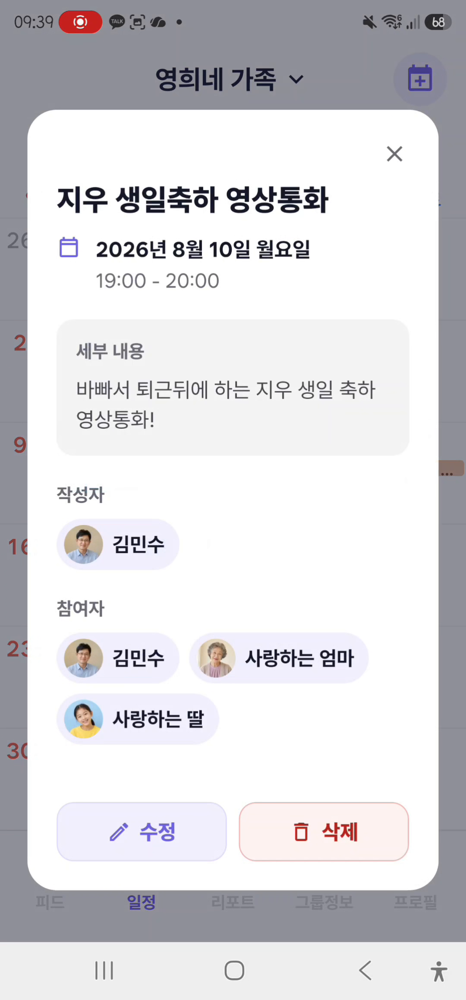 | 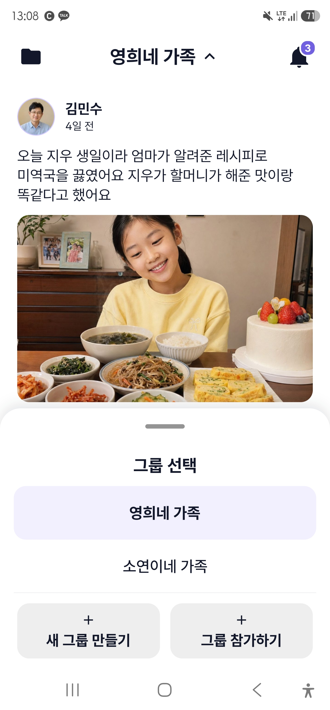 |

### 4. 카네이션 잔디와 알림

보호자가 하루에 게시글을 한 건 이상 작성하면 그룹별로 카네이션이 하루 한 개 적립됩니다. 월요일 기준 주간 랭킹과 지난주 1위 왕관을 제공하고, 사용자는 알림 유형별 수신 여부를 설정할 수 있습니다.

| 카네이션 달력 | 주간 효자랭킹 | 알림 설정 |
|:---:|:---:|:---:|
| 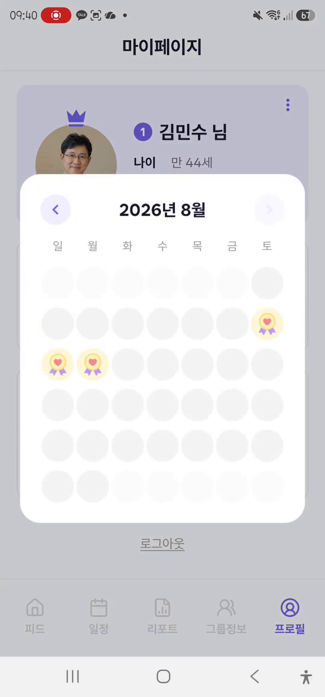 | 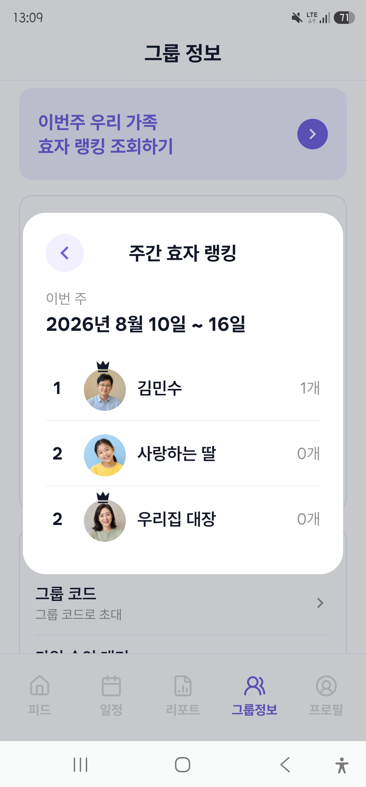 | 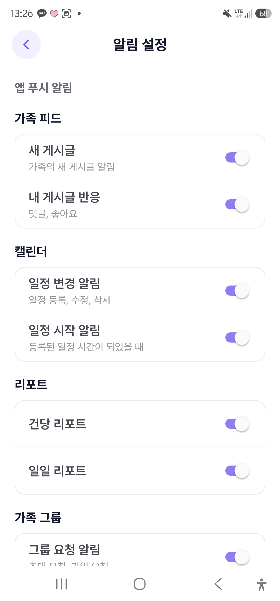 |

<details>
<summary><b>기능별 추가 화면 보기</b></summary>

| 일일 리포트 | 보관함 필터 | 날짜별 일정 |
|:---:|:---:|:---:|
| 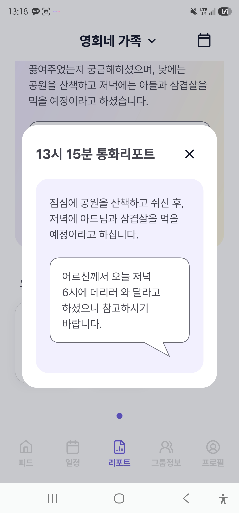 | 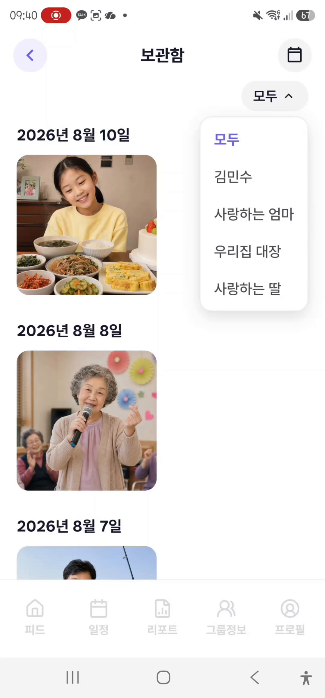 | 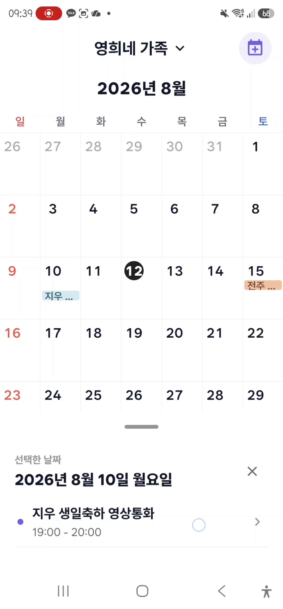 |

| 그룹 정보 | 카네이션 현황 | 알림 목록 |
|:---:|:---:|:---:|
| 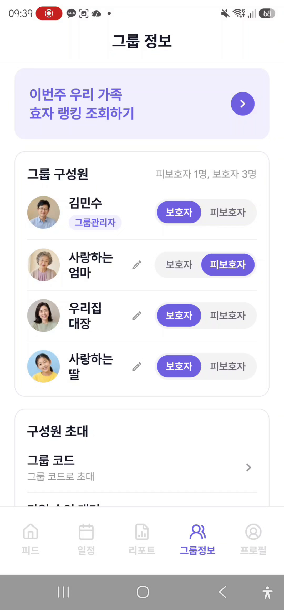 | 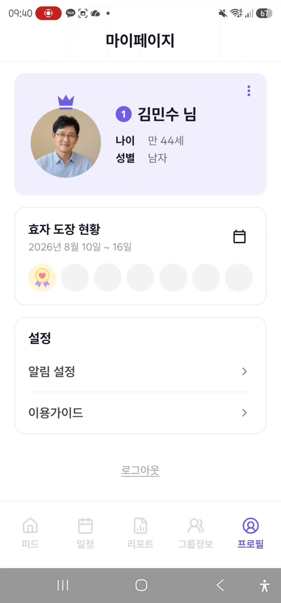 | 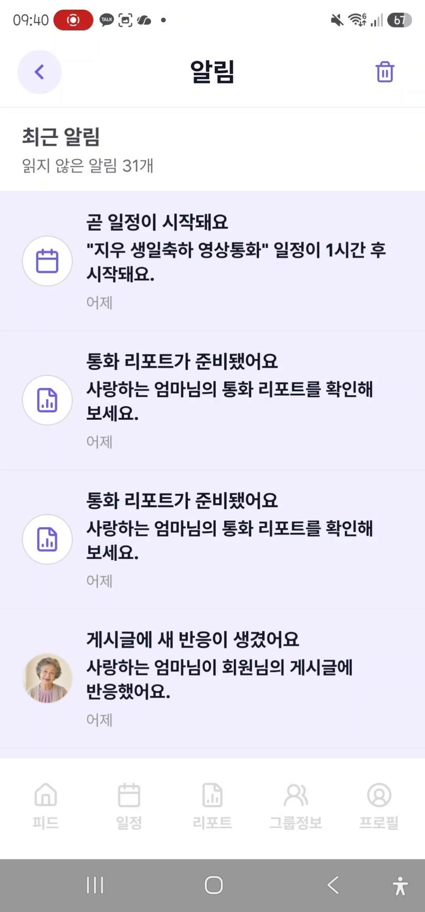 |

</details>

> 화면의 인물 사진과 게시글은 시연을 위해 제작한 데모 데이터입니다.

---

## 시스템 설계

### 프로젝트 운영 당시 인프라 구성

<a href="docs/readme-assets/architecture/infrastructure-architecture.svg">
  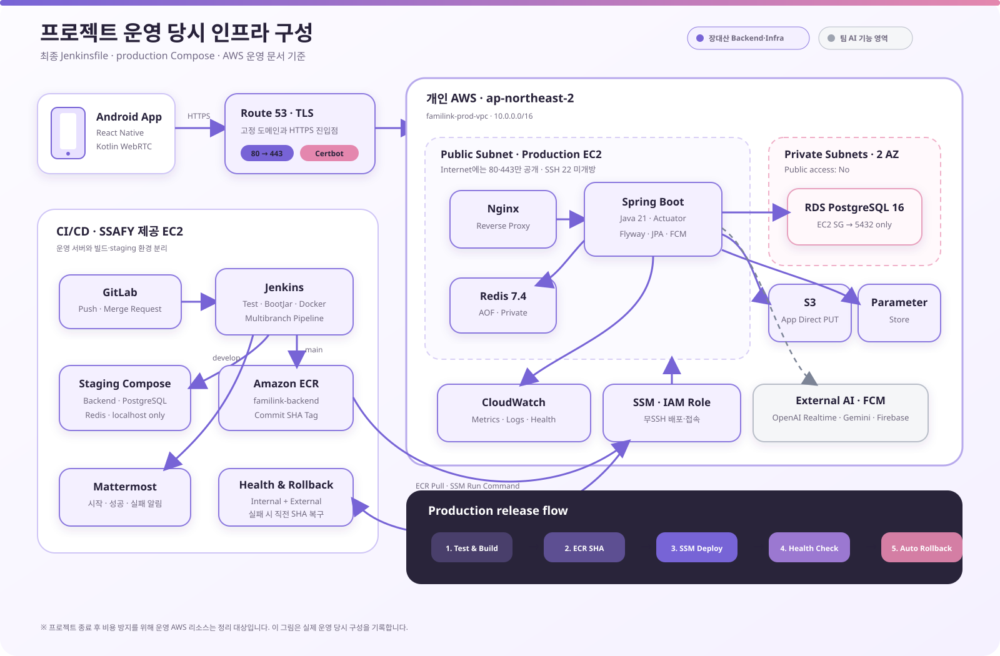
</a>

[SVG 원본](docs/readme-assets/architecture/infrastructure-architecture.svg) · [PNG 대체 이미지](docs/readme-assets/architecture/infrastructure-architecture.png)

최종 운영 환경은 초기 단일 서버 설계에서 발전해, **개인 AWS의 운영 환경**과 **SSAFY EC2의 CI·staging 환경**을 분리했습니다.

- 운영 EC2는 Public Subnet에서 Nginx·Spring Boot·Redis만 실행하고, PostgreSQL은 두 Private Subnet의 RDS에 격리했습니다.
- Jenkins는 Commit SHA로 이미지를 빌드해 ECR에 Push하고, SSH 대신 SSM으로 운영 EC2에 배포 명령을 전달했습니다.
- 내부 Actuator와 외부 HTTPS를 모두 확인하고 실패하면 직전 이미지로 자동 rollback했습니다.
- CloudWatch에서 호스트·컨테이너 health와 Backend·Nginx·배포 로그를 수집했습니다.
- 사진·영상은 앱이 비공개 S3에 직접 업로드하고, 운영 애플리케이션은 EC2 IAM Role로 AWS 서비스에 접근했습니다.

> 보라색 영역은 **장대산이 구축한 Backend·Infra 범위**, 회색 AI API 영역은 **팀의 AI 기능 범위**입니다. 현재는 프로젝트 종료 후 과금 방지를 위해 운영 리소스를 정리하고 있습니다.

### 데이터 모델

최종 Flyway 마이그레이션 V1부터 V12까지를 기준으로 **24개 테이블**을 계정·그룹, 피드·미디어, 캘린더·참여, 통화·리포트, 알림 도메인으로 구성했습니다. 주요 FK·Unique 제약과 운영 복구용 claim/event 테이블까지 포함합니다.

<details>
<summary><b>전체 ERD 펼쳐보기 — 24 tables</b></summary>

<br />

<a href="docs/readme-assets/erd/familink-erd.svg">
  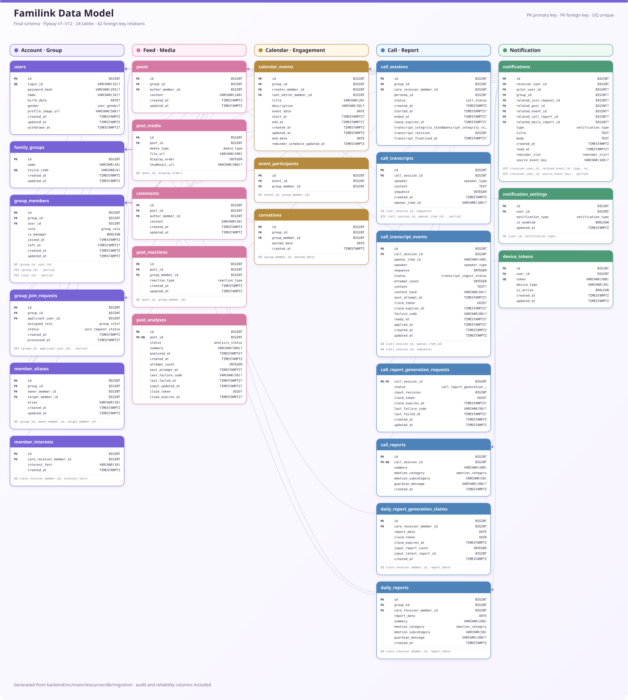
</a>

[SVG 원본](docs/readme-assets/erd/familink-erd.svg) · [PNG 대체 이미지](docs/readme-assets/erd/familink-erd.png)

가독성을 위해 반복되는 감사 컬럼은 일부 축약했으며, 전체 스키마는 프로젝트의 Flyway V1~V12 마이그레이션을 기준으로 검증했습니다.

</details>

### 주요 기술 선택

<details>
<summary><b>S3 Presigned URL — 애플리케이션 서버를 거치지 않는 미디어 업로드</b></summary>

1. 앱이 백엔드에 목적·MIME·크기를 포함한 업로드 URL을 요청합니다.
2. 백엔드는 정책을 검증하고 10분 유효한 PUT URL과 S3 Key를 반환합니다.
3. 앱은 원본 Blob을 S3로 직접 전송합니다.
4. 게시글 저장 시 백엔드가 허용된 Key와 스토리지 메타데이터를 다시 검증합니다.

이 구조로 대용량 파일이 Spring Boot 메모리와 네트워크를 점유하지 않으며, 비공개 버킷 정책을 유지했습니다.

</details>

<details>
<summary><b>Commit SHA 배포 — 재현 가능한 이미지와 자동 rollback</b></summary>

`main` 병합 시 Jenkins가 테스트·BootJar·Docker 빌드를 수행하고 전체 Commit SHA 태그로 ECR에 Push합니다. SSM 명령을 받은 운영 EC2는 새 이미지를 Pull한 뒤 backend 컨테이너만 교체합니다. 배포 전에 `.deployment/current-image`에서 직전 이미지를 읽어 두고, 내부·외부 health check 중 하나라도 실패하면 해당 이미지로 되돌립니다.

</details>

<details>
<summary><b>운영 경계 — Private RDS, 무SSH 접속, 최소 권한</b></summary>

RDS는 Public access를 끄고 EC2 Security Group에서 오는 5432만 허용했습니다. 운영 EC2에는 22번 포트를 열지 않고 Session Manager를 사용했으며, S3·ECR·Parameter Store·CloudWatch는 EC2 IAM Role의 최소 권한으로 접근했습니다.

</details>

---

## 팀과 기여

### 팀원 구성

| 손수호 | 이종철 | 홍유라 | 강다영 | 이경호 | 장대산 |
|:---:|:---:|:---:|:---:|:---:|:---:|
|  |  |  |  |  |  |
| **AI** | **AI** | **Frontend** | **Frontend** | **Backend** | **Backend · Infra** |
| [@shd437s](https://lab.ssafy.com/shd437s) | [@whdcjf5454](https://lab.ssafy.com/whdcjf5454) | [@hongula2000](https://lab.ssafy.com/hongula2000) | [@kdyarchive](https://lab.ssafy.com/kdyarchive) | [@rudgh8182](https://lab.ssafy.com/rudgh8182) | [@diqkraud](https://lab.ssafy.com/diqkraud) |

### 장대산 · Backend / Infra

| 영역 | 담당 내용 | 결과 |
|---|---|---|
| 백엔드 기반 | Java 21·Spring Boot 공통 환경, Flyway 전체 스키마, JPA Entity | 24개 테이블을 코드·DB 계약으로 관리 |
| 피드·소셜 | 게시글 CRUD·목록·상세·보관함, 댓글, 반응 | 그룹 권한과 미디어 정책을 일관되게 적용 |
| 미디어 | S3 Presigned URL 발급, 비공개 미디어 조회, Android Blob 업로드 안정화 | 서명 불일치와 모바일 원본 전송 문제 해결 |
| 참여 기능 | 카네이션 자동 적립·중복 방지, 달력·주간 랭킹 | KST 일자·월요일 경계와 공동 1위 처리 |
| AWS 운영 | VPC·Subnet·EC2·RDS·S3·ECR·SSM·Parameter Store·Route 53·CloudWatch | Private RDS와 무SSH 운영 환경 구성 |
| CI/CD | Jenkins 멀티브랜치 파이프라인, staging·production 분리, health check·rollback | Commit SHA 기반의 재현 가능한 자동 배포 |

#### 대표 트러블슈팅

- **모바일 S3 업로드 실패**: React Native 요청의 `Content-Length`와 서명 헤더 불일치를 분리해 추적하고, Blob 원본 전송과 서버가 반환한 서명 헤더를 그대로 사용하는 흐름으로 정리했습니다.
- **배포 실패 시 서비스 보호**: 새 컨테이너를 기동하기 전에 직전 이미지와 상태를 기록하고, 내부 Actuator·외부 HTTPS 검증 실패 시 자동 복구하도록 배포 스크립트를 구성했습니다.
- **민감정보와 운영 접속**: Access Key를 운영 `.env`에서 제거하고 EC2 IAM Role·Parameter Store·SSM으로 권한과 접속 경계를 분리했습니다.

> 개인 기여는 Git 커밋과 실제 코드·인프라 설정으로 확인되는 범위만 작성했습니다. **AI 모델·프롬프트 및 미디어 게시물 Direct Gemini 분석은 AI 팀 담당이므로 개인 기여에서 제외했습니다.**

---

## 로컬 실행

<details>
<summary><b>백엔드 실행</b></summary>

```bash
cd backend
cp .env.example .env
docker compose --env-file .env -f compose.local.yml up -d
./gradlew bootRun # Windows: .\gradlew.bat bootRun
```

- Health: `http://localhost:8080/actuator/health`
- Swagger UI: `http://localhost:8080/swagger-ui.html`
- 요구 사항: JDK 21, Docker·Docker Compose

</details>

<details>
<summary><b>Android 앱 실행</b></summary>

```bash
cd frontend
npm install
cp .env.development.example .env.development
npm run android:dev
```

- 요구 사항: Node.js 22.11+, JDK 17, Android Studio·Android SDK
- 지원 범위: Android 7.0(API 24) ~ Android 16(API 36)

</details>

<details>
<summary><b>테스트와 정적 분석</b></summary>

```bash
# Backend — Testcontainers 사용, Docker 필요
cd backend && ./gradlew test

# Frontend
cd frontend
npm test
npm run typecheck
npm run lint
```

</details>

### 저장소 구조

```text
S15P11B104/
├── backend/          # Spring Boot 3.5 · Java 21 · Flyway
├── frontend/         # React Native 0.86 · Kotlin Android module
├── infrastructure/   # AWS foundation · staging · production · CI/CD
├── docs/             # 스펙 · 계약 · QA · README assets
├── exec/             # 포팅 매뉴얼 · 외부 서비스 · 시연 자료
└── Jenkinsfile       # test → build → ECR → SSM deploy → rollback
```

---

<div align="center">

**가족의 일상을 대화로 잇다 — familink**

</div>
