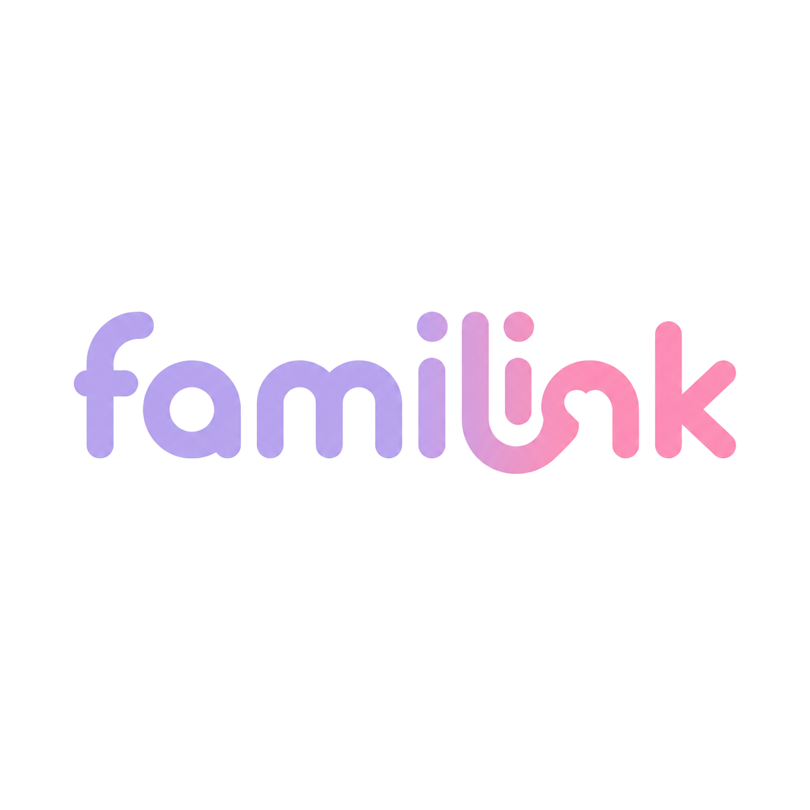

<div align="center">



# Familink

**AI 안부전화와 가족 간 일상 공유로 정서적 돌봄을 지원하는 서비스**

SSAFY 15기 2학기 공통 프로젝트 · 대전 1반 B104

</div>

---

## 목차

1. [프로젝트 소개](#1-프로젝트-소개)
2. [프로젝트 정보](#2-프로젝트-정보)
3. [프로젝트 결과물](#3-프로젝트-결과물)
4. [Contribute](#4-contribute)
5. [LICENSE](#5-license)
6. [외부 리소스 정보](#6-외부-리소스-정보)

---

## 1. 프로젝트 소개

### 프로젝트명

**Familink** — Family + Link. 떨어져 사는 가족을 하나의 그룹으로 연결합니다.

### 소개

바쁜 일상 속에서 부모님께 매일 전화드리기는 쉽지 않습니다. Familink는 **AI가 대신 안부전화를 걸고, 그 내용을 요약 리포트로 가족에게 전달**합니다. 여기에 가족 피드·공용 캘린더·카네이션 잔디 같은 가벼운 일상 공유 기능을 더해, 보호자와 피보호자(고령 가족)가 부담 없이 서로의 하루를 확인할 수 있게 합니다.

- **AI 안부전화** — 6종 페르소나 중 원하는 상대를 골라 발신하면, OpenAI Realtime API 기반 실시간 음성 대화가 진행되고 AI 발화가 실시간 자막으로 표시됩니다.
- **요약 리포트** — 통화가 끝나면 건별 리포트(요약·감정·전달 메시지)가 생성되고, 매일 밤 일일 리포트가 자동으로 만들어집니다.
- **가족 피드·보관함** — 사진·영상과 함께 일상을 올리고 댓글·반응을 남기며, 보관함에서 구성원·날짜별로 모아봅니다.
- **공용 캘린더** — 가족 일정과 기념일을 등록하고 참여자를 지정하면 일정 알림이 발송됩니다.
- **그룹 관리** — 초대 코드와 관리자 승인으로 가족 그룹을 꾸리고, 여러 그룹을 화면 내 토글로 오가며, 구성원에게 호칭(별칭)을 붙일 수 있습니다.
- **카네이션 잔디·주간 효자랭킹** — 하루 1건 이상 게시하면 잔디가 쌓이고, 주간 랭킹 1위에게 왕관이 씌워집니다.
- **알림** — 앱 내 알림 목록·읽음 처리, FCM 푸시, 유형별 수신 설정을 지원합니다.

### 디렉토리 구조

```text
S15P11B104/
├── backend/                  # Spring Boot 3.5 백엔드 (Java 21)
│   ├── src/main/java/com/ssafy/s15p11b104/
│   │   ├── domain/           # account, calendar, call, carnation, feed,
│   │   │                     # file, group, notification, report
│   │   └── global/           # ai, api, config, entity, exception, security
│   ├── src/main/resources/db/migration/   # Flyway 마이그레이션
│   └── compose.local.yml     # 로컬 PostgreSQL·Redis
├── frontend/                 # React Native 0.86 Android 앱 (TypeScript)
│   ├── src/
│   │   ├── features/         # ai-call, archive, auth, calendar, feed,
│   │   │                     # group-info, notifications, profile, reports
│   │   ├── app-shell/        # 그룹 전환 등 앱 셸 상태
│   │   ├── design/           # 디자인 토큰
│   │   ├── navigation/       # React Navigation 구성
│   │   └── shared/           # 공용 API 클라이언트·유틸
│   └── android/              # Kotlin 네이티브 (WebRTC AI 통화, FCM 모듈)
├── docs/                     # 공식 스펙(specs/), 컨벤션, QA, 기획 문서
├── infrastructure/           # AWS 기반, Jenkins CI, staging/production 컴포즈
└── Jenkinsfile               # 테스트 → 빌드 → ECR → 배포 파이프라인
```

---

## 2. 프로젝트 정보

### 사용 환경

| 구분 | 요구 사항 |
|---|---|
| 백엔드 | JDK 21, Docker(Compose), PostgreSQL 16 · Redis 7.4 (컴포즈로 자동 실행) |
| 프론트엔드 | Node.js ≥ 22.11.0, JDK 17, Android Studio + Android SDK |
| 지원 플랫폼 | Android 7.0(API 24) ~ Android 16(API 36) · 웹/iOS 미지원 |

모바일 앱 프로젝트로 브라우저는 지원하지 않습니다. (백엔드에 포함된 `/ai-call/` 웹 UI는 개발 검증 전용입니다.)

### 설치 및 실행 — 백엔드

```bash
cd backend
cp .env.example .env                                      # 환경변수 채우기 (아래 표 참고)
docker compose --env-file .env -f compose.local.yml up -d # PostgreSQL 16 + Redis 7.4
./gradlew bootRun                                         # Windows는 .\gradlew.bat bootRun
```

실행 확인: `http://localhost:8080/actuator/health` · Swagger `http://localhost:8080/swagger-ui.html`

주요 환경변수(`backend/.env.example`):

| 변수 | 용도 |
|---|---|
| `POSTGRES_*`, `REDIS_*` | 로컬 DB·캐시 접속 정보 |
| `OPENAI_API_KEY`, `OPENAI_REALTIME_MODEL` | AI 안부전화 실시간 음성 |
| `GMS_API_KEY` 또는 `GEMINI_*` | 리포트·게시글 분석용 Gemini 호출 |
| `GOOGLE_APPLICATION_CREDENTIALS`, `PUSH_ENABLED` | FCM 푸시 |
| `S3_*`, `AWS_*`, `MEDIA_*`, `FFPROBE_PATH` | 미디어 업로드·검증 |

### 설치 및 실행 — 프론트엔드(Android)

```bash
cd frontend
npm install                                    # postinstall에서 patch-package 적용
cp .env.development.example .env.development   # API_BASE_URL=http://10.0.2.2:8080 (에뮬레이터 기준)
npm run android:dev                            # Metro·기기 연결 검사 후 빌드 & 실행
```

`npm start`(Metro)와 `npm run android`를 따로 실행해도 됩니다. 릴리스 빌드는 `frontend/android/keystore.properties`에 서명 정보가 필요합니다.

### 테스트 및 정적 분석

```bash
# 백엔드 (Testcontainers 기반 — Docker 필요)
cd backend && ./gradlew test

# 프론트엔드
cd frontend && npm test
npm run typecheck && npm run lint
```

### 구현 목록

| 도메인 | 구현 내용 | 스펙 문서 |
|---|---|---|
| 계정·프로필 | 로그인 ID/비밀번호 인증(JWT), 회원가입·온보딩, 프로필·관심사, 탈퇴 | [docs/specs/domains](docs/specs/INDEX.md) |
| 그룹 | 그룹 생성, 초대 코드 + 관리자 승인 가입, 다중 그룹 전환, 호칭, 관리자 위임 | 〃 |
| 피드·미디어 | 140자 본문 + 사진 1~4장/영상 1개, 댓글·반응, 보관함 필터, 게시글 AI 분석 | 〃 |
| AI 통화 | 6종 페르소나, WebRTC 실시간 음성, 실시간 자막, Tool Calling | 〃 |
| 리포트 | 통화 건별 리포트(요약·감정·전달 메시지), 일일 리포트 자동 생성 | 〃 |
| 캘린더 | 일정 CRUD, 참여자 지정, 일정 알림, AI 일정 조회 연동 | 〃 |
| 알림 | 앱 내 알림 목록·읽음 처리, FCM 푸시, 유형별 수신 설정 | 〃 |
| 카네이션·랭킹 | 게시 기반 잔디 적립, 주간 효자랭킹, 지난주 1위 왕관 | 〃 |

### 간단한 사용 방법

1. 회원가입 후 가족 그룹을 만들고 **초대 코드**를 가족에게 공유합니다. 가입 요청은 그룹 관리자가 승인합니다.
2. 피보호자(부모님) 기기에서 **AI 전화 탭 → 페르소나 선택 → 발신**하면 AI와 음성 대화가 시작됩니다.
3. 통화가 끝나면 **리포트 탭**에서 건별 리포트를, 매일 밤에는 일일 리포트를 확인할 수 있습니다.
4. **피드**에 사진·영상으로 일상을 올리면 카네이션 잔디가 쌓이고, 주간 효자랭킹이 집계됩니다.

---

## 3. 프로젝트 결과물

### AI 안부전화

6종 페르소나 중 대화 상대를 고르면 말투 설명이 함께 표시되고, 발신하면 WebRTC 실시간 음성 대화가 시작됩니다. AI 발화는 실시간 자막으로 표시됩니다.

| 페르소나 선택 | 통화 (실시간 자막) |
|:---:|:---:|
|  |  |

### 요약 리포트

통화 종료 시 건별 리포트가 생성되고, 매일 밤 일일 리포트(요약·감정)가 자동 생성됩니다.

| 일일 리포트 | 통화 리포트 목록 |
|:---:|:---:|
|  |  |

### 가족 피드

사진·영상과 함께 일상을 공유하고 댓글·반응을 남깁니다.

| 피드 | 게시글 상세·댓글 |
|:---:|:---:|
|  |  |

### 보관함

가족이 올린 미디어를 모아 보고, 구성원·날짜별로 필터링합니다.

| 미디어 모아보기 | 구성원 필터 |
|:---:|:---:|
|  |  |

### 공용 캘린더

가족 일정·기념일을 등록하고 참여자를 지정하면 일정 알림이 발송됩니다.

| 월간 뷰 | 날짜별 일정 | 일정 상세 |
|:---:|:---:|:---:|
|  |  |  |

### 그룹 관리

초대 코드 + 관리자 승인으로 그룹을 꾸리고, 여러 그룹을 토글로 전환합니다.

| 그룹 정보·구성원 | 그룹 전환 |
|:---:|:---:|
|  |  |

### 카네이션 잔디 · 주간 효자랭킹

하루 1건 이상 게시하면 잔디(도장)가 적립되고, 주간 랭킹 1위에게 왕관이 씌워집니다.

| 도장 현황 | 도장 달력 | 주간 랭킹 |
|:---:|:---:|:---:|
|  |  |  |

### 알림

앱 내 알림 목록·읽음 처리와 FCM 푸시, 유형별 수신 설정을 제공합니다.

| 알림 목록 | 알림 설정 |
|:---:|:---:|
|  |  |

### 코드 설명

- **스펙 기반 개발** — 모든 기능은 [docs/specs](docs/specs/INDEX.md)의 로컬 스펙을 단일 기준으로 구현했습니다. API 계약은 [API.md](docs/specs/contracts/API.md), 데이터 모델은 [DATA_MODEL.md](docs/specs/contracts/DATA_MODEL.md)에 정리되어 있고, 스펙 변경은 `docs/spec-changes/`에서 제안 → 승인 → 반영 절차를 거칩니다.
- **AI 통화 파이프라인** — 앱(Kotlin `aicall` 네이티브 모듈)이 WebRTC로 음성을 주고받고, 백엔드가 OpenAI Realtime API와 WebSocket으로 중계합니다. 통화 전사는 Gemini 기반 리포트 생성(건별·일일)으로 이어집니다. 상세 설계는 [AI_CALL_README.md](AI_CALL_README.md) 참고.
- **단일 백엔드 구성** — AI 오케스트레이션을 포함한 모든 서버 로직을 Spring Boot 하나가 담당합니다(별도 Python 서비스 없음). 도메인별 패키지(`domain/*`)와 전역 관심사(`global/*`)를 분리했고, 스키마는 Flyway로 버전 관리합니다.
- **React Native + 네이티브 브리지** — 화면은 React Native(TypeScript)로, WebRTC 통화·FCM 수신처럼 플랫폼 기능이 필요한 부분만 Kotlin 모듈로 구현해 Codegen(TurboModule)으로 연결했습니다.
- **CI/CD** — Jenkins Multibranch Pipeline이 테스트 → 이미지 빌드 → ECR 푸시 → develop은 스테이징, main은 운영(SSM 배포 + 헬스체크 + 롤백)으로 이어집니다.

### 팀 · 후기

| 이름 | 역할 | 후기 |
|---|---|---|
| 강다영 | | |
| 손수호 | | |
| 이경호 | | |
| 이종철 | | |
| 장대산 | | |
| 홍유라 | | |

---

## 4. Contribute

프로젝트에 기여하려면 아래 절차를 따라 주세요.

1. **이슈 확인** — Jira(S15P11B104) 티켓 기준으로 작업합니다. 새 작업은 티켓을 먼저 만들고 담당자·기한을 지정합니다.
2. **브랜치 생성** — `develop`에서 분기합니다. 브랜치 이름은 `feature/S15P11B104-<티켓번호>-<요약>`, 버그는 `fix/...` 형식을 따릅니다.
3. **구현 전 스펙 확인** — [docs/specs/INDEX.md](docs/specs/INDEX.md)에서 관련 스펙을 먼저 읽고, 스펙과 다르게 구현해야 한다면 코드가 아니라 `docs/spec-changes/`에 변경 제안을 먼저 올립니다.
4. **컨벤션 준수** — [Java](docs/conventions/java.md) · [Kotlin](docs/conventions/kotlin.md) · [React Native/TypeScript](docs/conventions/react-native.md) 컨벤션과 커밋 메시지 규칙(`[S15P11B104-<번호>] <타입>: <설명>`)을 따릅니다.
5. **검증 후 MR** — 변경 범위에 맞는 테스트(`./gradlew test`, `npm test`)와 정적 분석(`npm run typecheck`, `npm run lint`)을 통과시킨 뒤 `develop` 대상 MR을 올립니다. MR은 리뷰 승인 후 병합합니다.

환영하는 기여: 버그 수정, 테스트 보강, 스펙 문서와 실제 구현의 불일치 제보, 접근성 개선. 스펙에 없는 신규 기능은 이슈로 먼저 논의해 주세요.

---

## 5. LICENSE

이 프로젝트는 **MIT License**를 따릅니다.

> SSAFY 교육 과정에서 진행된 프로젝트로, 저장소 공개 범위와 라이선스 적용은 SSAFY 정책을 우선합니다.

---

## 6. 외부 리소스 정보

| 리소스 | 용도 | 라이선스/비고 |
|---|---|---|
| [OpenAI Realtime API](https://platform.openai.com/docs/guides/realtime) | AI 안부전화 실시간 음성 대화 (`gpt-realtime-2`) | OpenAI 이용약관 (상용 API) |
| [Google Gemini API](https://ai.google.dev/) | 통화·일일 리포트, 게시글 분석 (`gemini-2.5-flash-lite`, `gemini-3.5-flash`) — SSAFY GMS 프록시 경유 | Google API 이용약관 |
| [Firebase Cloud Messaging](https://firebase.google.com/products/cloud-messaging) | 푸시 알림 (서버 `firebase-admin`, 앱 `firebase-messaging`) | Apache-2.0 (SDK) |
| [webrtc-sdk/android](https://github.com/webrtc-sdk/android) | 앱 내 WebRTC 음성 통화 | BSD-3-Clause (libwebrtc) |
| [Spring Boot](https://spring.io/projects/spring-boot) 및 스타터 | 백엔드 프레임워크 | Apache-2.0 |
| [React Native](https://reactnative.dev/) · [React Navigation](https://reactnavigation.org/) | 앱 프레임워크·내비게이션 | MIT |
| [AWS SDK for Java v2](https://github.com/aws/aws-sdk-java-v2) | S3 미디어 스토리지 | Apache-2.0 |
| [PostgreSQL](https://www.postgresql.org/) · [Redis](https://redis.io/) | 데이터베이스·캐시 | PostgreSQL License · RSALv2/SSPL |
| [Flyway](https://github.com/flyway/flyway) | DB 마이그레이션 | Apache-2.0 |
| [JJWT](https://github.com/jwtk/jjwt) | JWT 발급·검증 | Apache-2.0 |
| [springdoc-openapi](https://springdoc.org/) | Swagger API 문서 | Apache-2.0 |
| [Lucide](https://lucide.dev/) (`lucide-react-native`) | 앱 아이콘 | ISC |
| [Material Design Icons](https://github.com/react-native-vector-icons/react-native-vector-icons) | 앱 아이콘 | MIT (아이콘 Apache-2.0) |
| [Testcontainers](https://testcontainers.com/) | 백엔드 통합 테스트 | MIT |

앱 화면에 사용된 인물 사진 등 데모 콘텐츠는 시연용으로 생성된 이미지입니다.
