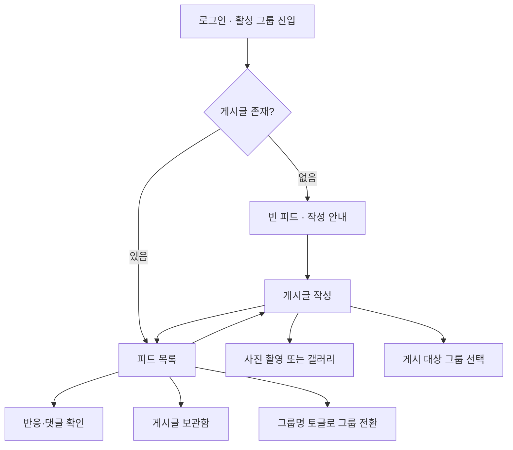
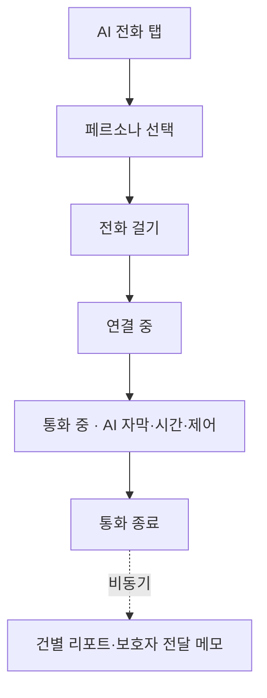

# 사용자 흐름도

> 원본: [Notion 사용자 흐름도](https://app.notion.com/p/399e66fae1928078a5dee95aa398645d)  
> Notion 최신 확인: 2026-07-24

## 1. 공통 진입

1. 로그인 후 활성 그룹이 있으면 마지막 이용 그룹의 피드로 진입한다.
2. 활성 그룹이 없으면 그룹 생성·참가 화면으로 이동한다.
3. 초대 코드를 입력해 가입 요청을 만들고, 그룹 관리자가 보호자·피보호자 역할을 지정해 승인 또는 거절한다.
4. 사용자 ID 검색·ID 직접 초대·받은 초대 목록은 제공하지 않는다.

## 2. 피드

- 텍스트만 작성하거나 사진 최대 4장 또는 영상 최대 1개를 첨부한다.
- 사진과 영상은 한 게시글에 함께 첨부하지 않는다.
- 게시글 작성자는 자신의 게시글을 수정·삭제하고, 그룹원은 이모지 반응과 댓글을 남긴다.
- 게시글 보관함은 구성원·날짜로 필터링한다.

## 3. AI 전화

- 피보호자가 원할 때 직접 시작하며 예약·자동 발신 시간은 사용하지 않는다.
- AI 발화만 실시간 자막으로 표시하고 사용자 발화 자막은 표시하지 않는다.
- 통화 종료 후 건별 리포트와 보호자 전달 메모를 생성한다.
- 녹음 원본과 전체 통화 전문은 저장하지 않는다.

## 4. 일일 리포트

1. 보호자가 리포트 탭에서 피보호자와 날짜를 선택한다.
2. 통화 기록이 없으면 빈 상태를 표시한다.
3. 통화 기록이 있으면 최대 200자 일일 요약을 표시한다.
4. 일일 리포트에는 대표 감정 대분류 이모지, 세부분류 텍스트, 보호자 전달 메모 배열을 표시한다.
5. 건별 리포트는 접힌 상태로 보이며 선택하면 최대 100자 요약을 확인한다.
6. 건별 감정은 화면에 표시하지 않는다.
7. 여러 피보호자 전환은 구성원 필터가 아니라 화면 좌측 넘김으로 처리한다.

## 5. 캘린더

- 월간 달력에서 날짜를 선택하고 일정 목록·상세·추가·수정·삭제를 수행한다.
- 승인된 그룹원은 공용 일정을 공동 편집한다.
- 일정 시간이 있으면 시작 1시간 전, 날짜만 있으면 전날 09:00에 한 번 알림을 보낸다.
- 단말 기본 캘린더와 연동하지 않는다.
- AI 통화의 `get_calendar_events_by_date`는 전처리된 `target_date`로 해당 날짜의 모든 가족 일정을 조회한다.

## 6. 마이페이지·그룹 관리

- 보호자는 활동 달력, 카네이션 잔디, 주간 효자랭킹과 그룹 관리를 확인한다.
- 피보호자는 관심사를 자유 입력·태그로 최대 10개 설정하고 AI 대화 소재로 사용한다.
- 별도 호칭이 없으면 상대의 사용자명을 기본 표시한다.
- 관리자는 참가 요청 승인 시 역할을 지정하고 구성원 역할을 변경할 수 있다.
- 다른 구성원이 있는 그룹의 관리자는 권한을 위임한 뒤 나간다.
- 관리자 단독 그룹에서 나가기는 그룹 삭제 확인으로 연결한다.

## 7. 예외 흐름

### 활성 그룹이 없는 사용자

- 그룹 생성·참가 화면에서 코드 입력과 승인 대기 상태 확인이 가능하다.
- 마이페이지에는 진입할 수 없다.
- 뒤로가기를 누르면 로그인 상태의 화면에서 로그아웃·회원탈퇴를 이용한다.

### 역할 구성원이 없는 그룹

- 생성자가 선택한 한 역할만 있어도 즉시 정상 이용한다.
- 역할 부족으로 유예·비활성·`PENDING`·`READ_ONLY` 전환을 하지 않는다.
- 피드·캘린더·그룹 관리 기능을 제한하지 않는다.
- 필요한 구성원 초대와 역할 지정은 서비스 이용 중 계속 수행한다.
