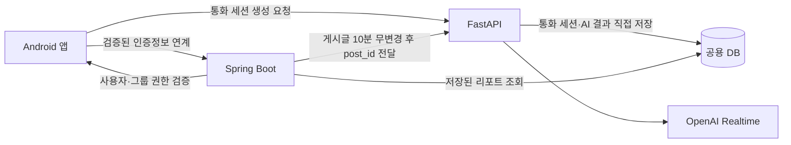

# Realtime Voice PoC 서비스 경계 검증

> 이 문서는 현재 Android/FastAPI PoC를 최신 Notion 개발 문서와 비교한 검증 메모다. 제품 확정 설계가 아닌 PoC와 제품 문서 사이의 차이를 기록한다.
>
> 기준 문서: [AI 전화 Tool Calling 및 통화 전후 처리](https://app.notion.com/p/3a4e66fae19281ec8a8dcbbfbe4ee948), [프로젝트 루트 System Architecture](https://app.notion.com/p/a07e66fae192822d8862011c73e2305e), [백엔드에게 전달사항](https://app.notion.com/p/3a5e66fae192806e966cc09a8ed025ac)

## 1. Notion 기준 서비스 경계

- 프론트엔드는 Spring Boot에서 검증된 인증정보를 연계해 FastAPI에 통화 세션 생성을 직접 요청한다.
- Spring Boot는 사용자·그룹 권한 검증, 게시글 수정 시각 관리, 저장된 리포트 조회와 화면 제공을 담당한다.
- FastAPI는 AI 통화 세션, 가능한 통화 처리, 게시글 분석, 건별·일일 리포트 생성과 AI 결과 DB 기록을 담당한다.
- FastAPI가 `call_sessions`, `call_reports`, `daily_reports`, 게시글 분석 결과를 직접 생성·갱신한다. 완료 콜백이나 Spring Boot의 리포트 생성 요청은 사용하지 않는다.
- 게시글 분석은 Spring Boot가 마지막 수정 후 10분 무변경을 확인해 `post_id`를 FastAPI에 전달하는 방식으로 기록돼 있다.
- 프론트엔드가 FastAPI를 직접 호출할 때 사용할 인증정보의 발급·전달·검증 방식과 양쪽 서비스가 공동 갱신할 필드 범위는 아직 추가 결정이 필요하다.

## 2. 통화 시작·Tool Calling 계약

- 프론트엔드는 선택한 페르소나 번호를 FastAPI에 전달한다.
- FastAPI는 번호를 고정 매핑해 OpenAI Realtime의 음성과 말투 프롬프트를 적용한다.
- `personas` DB와 Spring DB의 `voice_id`는 사용하지 않는다.
- 통화 시작 시 현재 가족 그룹의 당일 게시글 분석 결과를 시스템 프롬프트에 한 번 주입한다. 이 처리는 Tool Calling이 아니다.
- 필수 Tool은 다음 두 가지다.
  - `get_person_recent_post_summaries`: 현재 그룹의 특정 인물 최신 게시글 요약 최대 5개. 원문·미디어는 반환하지 않는다.
  - `get_calendar_events_by_date`: `target_date` 기준 해당 날짜의 모든 가족 일정. `keyword`는 사용하지 않는다.
- 상대 날짜는 AI가 계산하지 않고 별도 전처리 로직이 `YYYY-MM-DD`로 변환한다.
- 주제 관련 게시글 검색과 장기 메모리 검색은 확장 범위다.

## 3. 통화 종료·리포트 계약

- 통화 종료 직후 FastAPI가 최대 100자의 건별 요약을 비동기로 생성해 `call_reports`에 직접 저장한다.
- 건별 결과에는 `summary`, `emotion_category`, `emotion_subcategory`, nullable `guardian_message`가 포함된다.
- 감정 대분류는 `분노·슬픔·불안·상처·당황·기쁨·중립`이며, 세부분류는 텍스트로 분리 저장한다.
- 건별 감정은 저장하지만 건별 리포트 화면에는 표시하지 않는다.
- 보호자 전달사항은 통화 중 Tool Calling이 아니라 리포트 생성 단계에서 함께 만든다.
- FastAPI는 매일 Asia/Seoul 22시에 당일 건별 리포트를 조회해 통화가 있는 피보호자별 최대 200자 일일 리포트를 직접 저장한다.
- 일일 화면에는 대표 대분류 이모지, 세부분류 텍스트, `guardianMessages`를 표시한다.
- 당일 통화가 없으면 일일 리포트를 생성하지 않는다. 건별·일일 리포트는 재생성하지 않는다.
- 녹음 원본과 전체 통화 전문은 저장하거나 보호자에게 제공하지 않는다.
- 중립 세부분류, 전체 세부분류 목록, 여러 통화의 대표 감정 집계, 보호자 전달 채널과 상태 추적은 미정이다.

## 4. 현재 PoC와의 차이

현재 PoC는 독립적인 세션 연결 검증 범위다. 다음 항목은 제품 구현 완료를 의미하지 않는다.

- PoC의 `/realtime/session`은 인증·그룹 권한 검증과 제품용 `call_sessions` 저장을 구현하지 않는다.
- PoC의 모델·음성·VAD 값은 재현용 환경값이며 제품 확정 계약으로 사용하지 않는다.
- PoC는 리포트·감정·보호자 전달 메모·게시글 맥락·필수 Tool을 제공하지 않는다.
- PoC에서 서버 직접 JWT 검증, 별도 Call Orchestrator, sideband 상태 머신, TTL 버퍼, 재시도·멱등성·데드레터, rate limit·동시성·비용 제한을 제품 필수사항으로 단정하지 않는다. 필요한 경우 별도 결정 후 문서화한다.

## 5. 검증 체크리스트

PoC를 제품 방향과 비교할 때 다음 경계만 확인한다.

- Android에 API Key가 들어가지 않는가.
- 세션 생성 요청이 FastAPI로 전달되는가.
- 인증·그룹 권한 검증 주체가 Spring Boot 경계와 일치하는가.
- 통화 종료 시 녹음 원본·전체 전문을 보관하지 않는가.
- 향후 리포트 파이프라인이 FastAPI 직접 저장·Spring DB 조회 방향을 따르는가.
- 제품 API·ERD의 미확정 필드를 PoC 기본값으로 확정하지 않는가.

## 관련 로컬 문서

- [프로젝트 요구사항](../../docs/requirements.md)
- [프로젝트 기획서](../../docs/project-plan.md)
- [사용자 흐름](../../docs/user-flow.md)
- [개발 계약 요약](../../docs/development-contracts.md)
- [설계 계약 요약](../../docs/design-contracts.md)
- [FastAPI 세션 프록시](../backend/app/main.py)
- [Android Realtime 통화 클라이언트](../android/app/src/main/java/com/example/realtimevoicepoc/RealtimeCallClient.kt)
